  

  <a href="https://nafisiqbalneloy.github.io"><b>Portfolio</b></a> ·
  <a href="https://www.linkedin.com/in/nafisiqbalneloy/"><b>LinkedIn</b></a>

I'm a CSE student at United International University (UIU), Dhaka, majoring in AI and Data Science. My research interest is **AI security**, in particular **data poisoning in retrieval-augmented generation (RAG)**. Next to that I build full-stack and ML projects, and I work as a Sales Executive at a software startup.

## Research

> **Do existing RAG poisoning defenses work equally well in English, Bangla and Banglish?**

A RAG system answers questions using documents it retrieves, so a poisoned document can mislead it. Most defenses are tested only in English, but the same word can be written three ways, which may change what gets retrieved and what gets caught:

  <b>good</b> &nbsp;·&nbsp; <b>ভালো</b> &nbsp;·&nbsp; <b>bhalo</b> 
  English &nbsp;·&nbsp; Bangla &nbsp;·&nbsp; Banglish

- **Status:** final year design project with a group of five, at the literature review stage. The topic, datasets, attack and defense are still being chosen with our supervisor.
- **Areas:** AI security, adversarial machine learning, multilingual and low-resource NLP.

## Projects

<table>
  <tr>
    <td width="50%" valign="top">
      <a href="https://github.com/nafisiqbalneloy/Garbage-Classification-Using-Deep-Learning"><b>Garbage Classification</b></a> 
      Image classifier that sorts waste into 10 classes, with a Gradio demo. 
      Python · PyTorch · EfficientNet-B6
    </td>
    <td width="50%" valign="top">
      <a href="https://github.com/nafisiqbalneloy/CampusCruise"><b>CampusCruise</b></a> 
      Bike ride-sharing app for UIU students: accounts, ride matching, fare chat, admin dashboard. 
      Node.js · SQLite · JavaScript
    </td>
  </tr>
  <tr>
    <td width="50%" valign="top">
      <a href="https://github.com/nafisiqbalneloy/GaanBox"><b>GaanBox</b></a> 
      Share a song and the story behind it, with likes and reports. 
      JavaScript · Node.js
    </td>
    <td width="50%" valign="top">
      <a href="https://github.com/nafisiqbalneloy/nafisiqbalneloy.github.io"><b>Portfolio website</b></a> 
      My personal site: projects, experience and education. 
      HTML · CSS · JavaScript
    </td>
  </tr>
</table>

## Work and study

- 💼 **Sales Executive**, [Intelio Labs](https://inteliolabs.com/) (software startup, remote), since November 2026
- 🎓 **B.Sc. in CSE**, United International University, since 2023
- 🎯 **Next:** moving towards AI engineering, learning more about RAG and applied ML

## Skills

  

## Contributions

  

